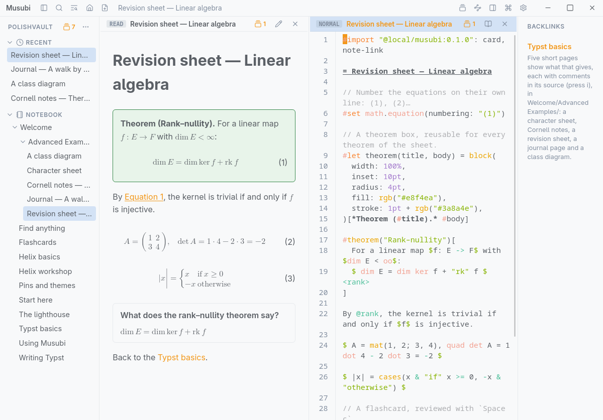

# Musubi

Local-first notes written in [Typst](https://typst.app), read in a native view
and edited the [Helix](https://helix-editor.com) way.



## What Musubi is

- **Notes are Typst files** in a plain folder you own. No database, no lock-in:
  every note still compiles with `typst compile`.
- **A native reading view**, not a PDF viewer: formatted text, equations,
  tables, links and checkboxes, in the theme of the app, with a block cursor
  you move with the keyboard.
- **Helix-style modal editing** of the whole source file, checked key by key
  against the real Helix, and usable with the mouse.
- **Links, backlinks and a graph** between notes, grouped by folder if you
  like.
- **Flashcards** written in the notes and scheduled with FSRS.
- **Search** by title and in the text of every note; pins, recent notes,
  archive and trash.
- **Bring your own sync**: Syncthing, Nextcloud, git… Musubi only handles the
  conflict copies they leave behind.
- Themes (Ayu, GitHub, or your own) and preferences for fonts, sizes and the
  editor. Linux first, Android later.


## A note

```typst
#import "@local/musubi:0.1.0": card, note-link, todo

= Linear maps

A linear map $f: E -> F$ keeps sums and scalings. Its kernel says when it is
injective: see #note-link("Maths/Kernels")[kernels].

#card[What does the rank–nullity theorem say?][$dim E = dim ker f + "rk" f$]

- #todo[Do the exercises of chapter 3]
```

`note-link`, `card` and `todo` come from the small `musubi` Typst package,
built into the app; outside Musubi, the note compiles with the package of
[`typst/musubi/`](typst/musubi/).

## Keys

Every action has a `Space` shortcut, as in Helix, and is in the command
palette (`Space ?`) and, for the main ones, in the title bar.

| Keys                     | Action                                             |
| ------------------------ | -------------------------------------------------- |
| `Space f`, `Space /`     | Find a note by title, search the text of the notes |
| `Space n`                | New note                                           |
| `Space r`                | Switch between reading and editing                 |
| `Space g`                | Graph of the links                                 |
| `Space c`                | Review the flashcards                              |
| `Space o`                | Home: recent and pinned notes                      |
| `Space e`, `Space b`     | Explorer, backlinks                                |
| `Space w v`, `Space w q` | Split the pane, close it                           |
| `Space ,`                | Settings                                           |
| `j` `k`, `gg` `ge`, `/`  | Reading view: move between blocks, search          |
| `i`, `:w`, `:q`          | Edit the note, save, back to reading               |

A tutorial opens in a new vault: a treasure hunt through the reading view,
Helix editing, links, the graph and flashcards.

## Install

Musubi runs on Linux. Each
[release](https://github.com/mumpkin/musubi/releases) has an `.AppImage`
and a `.deb`.

On Arch Linux, the AUR package `musubi-bin` installs the `.deb` of the
latest release:

```sh
paru -S musubi-bin    # or yay -S musubi-bin, or makepkg -si from the AUR
```

Its `PKGBUILD` lives in [`packaging/aur/`](packaging/aur/):
`packaging/aur/update.sh <version>` points it at a new release and writes
`.SRCINFO` again; the maintainer then pushes it to the AUR.

## Development

Requirements: Node.js 24 or later, pnpm (version pinned in `package.json`),
Rust stable, and the
[Tauri system dependencies](https://v2.tauri.app/start/prerequisites/).

```sh
pnpm install          # also installs the git hooks (lefthook)
pnpm dev:tauri        # desktop app
```

| Command                                                 | Purpose                                                    |
| ------------------------------------------------------- | ---------------------------------------------------------- |
| `pnpm dev`                                              | Interface only, in a browser                               |
| `pnpm dev:tauri`                                        | Desktop app                                                |
| `pnpm check`                                            | Lint and format check (ESLint, Prettier), Rust file length |
| `pnpm fix`                                              | Apply the automatic fixes and formatting                   |
| `pnpm typecheck`                                        | Type checking (TypeScript, Svelte)                         |
| `pnpm test`                                             | Unit tests (Vitest)                                        |
| `pnpm test:coverage`                                    | Unit tests with coverage                                   |
| `pnpm duplicates`                                       | Duplicate code detection (jscpd)                           |
| `pnpm build:tauri`                                      | AppImage and `.deb` packages                               |
| `cargo test`                                            | Rust tests; also regenerates the TS bindings               |
| `cargo clippy --workspace --all-targets -- -D warnings` | Rust lint                                                  |

See [CONTRIBUTING.md](CONTRIBUTING.md) for the code rules, branches, commit
messages and the changelog.

## Repository layout

```
apps/desktop/          Tauri 2 app: Svelte 5 interface (src/), Rust commands (src-tauri/)
crates/musubi-core/    Rust: vault, file naming, links, index (SQLite), flashcards
crates/musubi-typst/   Rust: Typst compilation, HTML export, source positions
packages/editor/       TypeScript: CodeMirror 6 and the Helix profile
typst/musubi/          the `musubi` Typst package
tutorial/              the tutorial, installed in new vaults
examples/              a demo vault
packaging/aur/         the AUR package `musubi-bin`
docs/                  vault format, architecture, performance, themes
tools/                 repository scripts, the Helix reference recorder
```

[docs/architecture.md](docs/architecture.md) explains how these fit together
and where to change what.

Types shared between Rust and TypeScript are generated with
[ts-rs](https://github.com/Aleph-Alpha/ts-rs) into
`apps/desktop/src/lib/bindings/` when running `cargo test`.

## License

[GPL-3.0-or-later](LICENSE)

The built-in color themes take their colors from
[primer/github-vscode-theme](https://github.com/primer/github-vscode-theme)
and [ayu-theme/vscode-ayu](https://github.com/ayu-theme/vscode-ayu) (MIT,
see [docs/themes.md](docs/themes.md#credits)).
